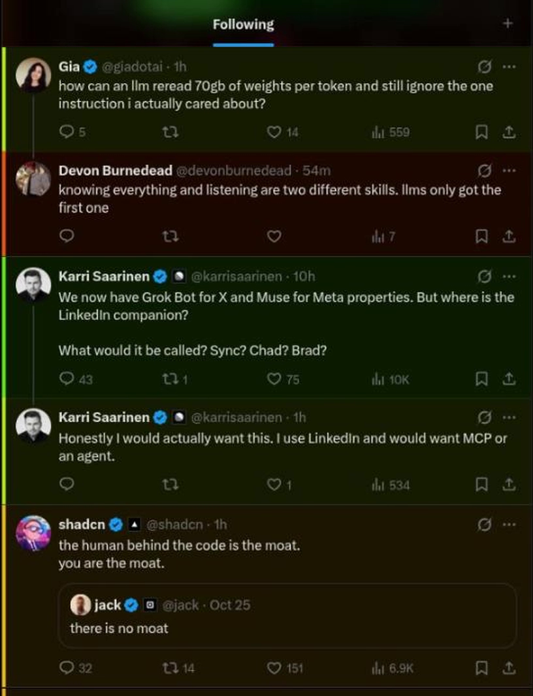

# xworth

A Chrome extension that colors each X post red to green by how much of your time it is worth, and locks the home feed to people you follow.

## Why

Summaries of a feed lose the posts that mattered, and no model reads a whole timeline for you. So xworth leaves every post in place and paints it: red is ragebait, memes and hot takes, green is something you can learn from or use today. You still scroll, but you know where to slow down.

The second half is the feed lock. The For you tab, Trending, Who to follow and the news card are hidden, and home opens on Following. You only see the people you chose.

## How it works

- Each post's visible text goes to a judge that scores it 0 to 4, from Waste to Great. The levels and the reader profile live in `config.js`.
- Three engines:
  - `small` (default): EmbeddingGemma on Ollama plus a ridge head in `head.json`, distilled from Jev's scores. About 20 ms per post.
  - `local`: Qwen3.5-9B on llama-server. The score is the expected level over the digit logprobs, so it is smooth from 0 to 1. About 0.1 s per post.
  - `jev`: the TypeSafe Jev API. Needs a key.
- 0 paints red, the top level paints green. Paint is keyed by post id, because X recycles post nodes while you scroll.
- The feed lock is plain CSS plus one click on the Following tab. It uses no English labels, so it works with X in any language.

## Results

On 45 held-out posts labelled by Claude as a reference, Spearman correlation was 0.86 for Jev, 0.82 for Qwen3.5-9B and 0.74 for the small engine. The small head trained on 336 posts.

## Run it

1. Copy `config.example.js` to `config.js`.
2. Edit `WORTH.instructions` to describe you. The default reader is a freelancer building AI automations, so the colors follow that taste.
3. Pick an `ENGINE`:
   - `small`: run Ollama with `embeddinggemma` and `OLLAMA_ORIGINS=chrome-extension://*`.
   - `local`: run llama-server on port 8089 with a chat model.
   - `jev`: set `KEY`.
4. Set `FEED_LOCK = false` if you want X's layout left alone.
5. Open `chrome://extensions`, turn on Developer mode, click Load unpacked and pick this folder. Works in Chrome and Brave. Reload the extension after editing `config.js`.

## Retraining the small engine

The small head learned the default levels and reader. After you change `WORTH`, delete `bench/labels.jsonl` and run `python distill.py --write` from `bench/`. It re-labels with Jev, so it needs a key, plus numpy, scikit-learn and scipy.

Other bench scripts: `harvest.mjs` collects posts from the public profiles in `handles.txt`, `bench.py` scores them, and `score.py` and `parity.js` check results. The data files (`harvest.jsonl`, `labels.jsonl`, `posts.json`) are not in the repo. `harvest.mjs` and `distill.py` rebuild the first two.

## Stack

JavaScript (Chrome Manifest V3), Ollama EmbeddingGemma, llama.cpp, TypeSafe Jev, Python.
